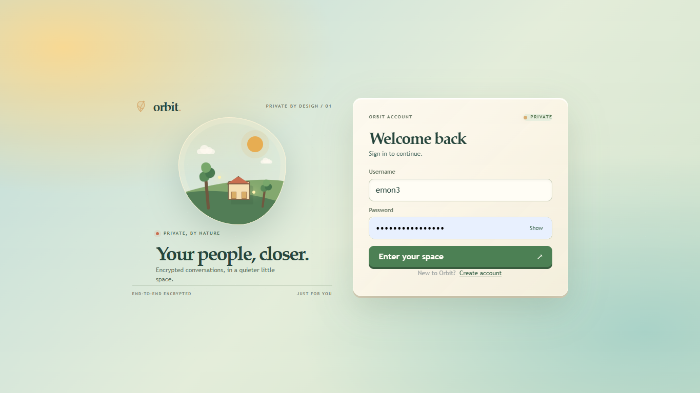
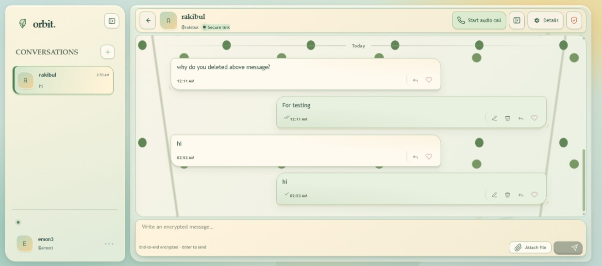
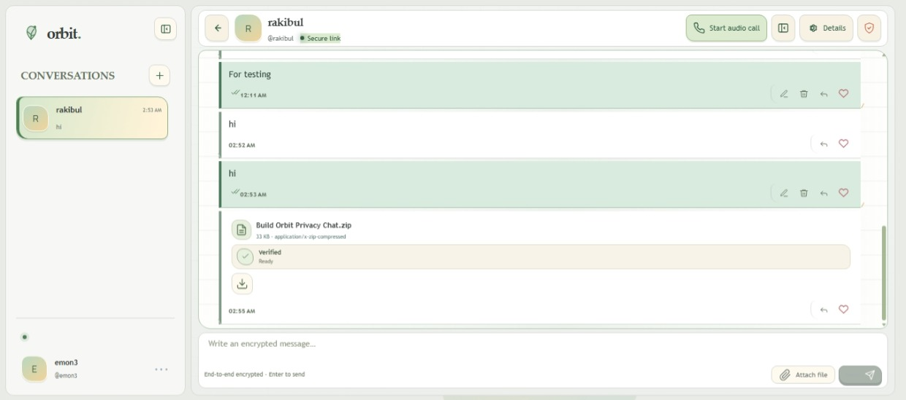
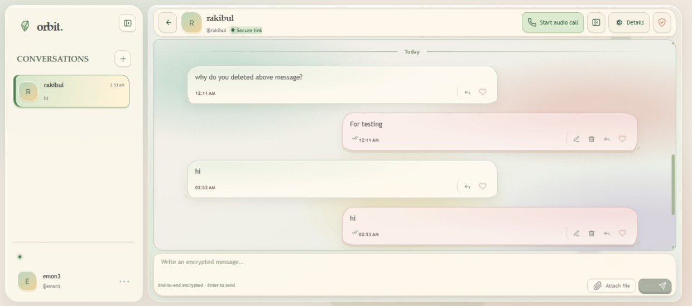
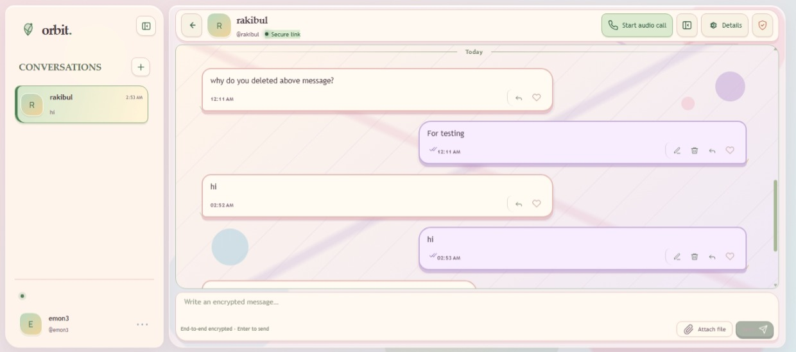
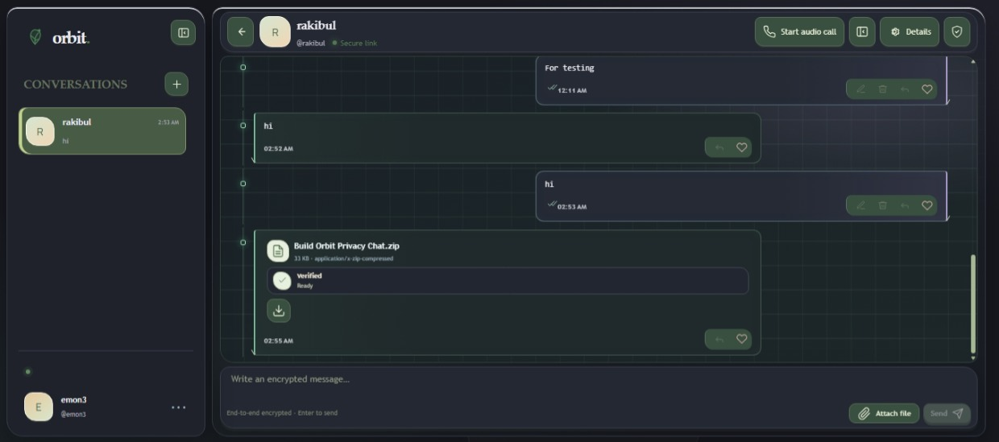
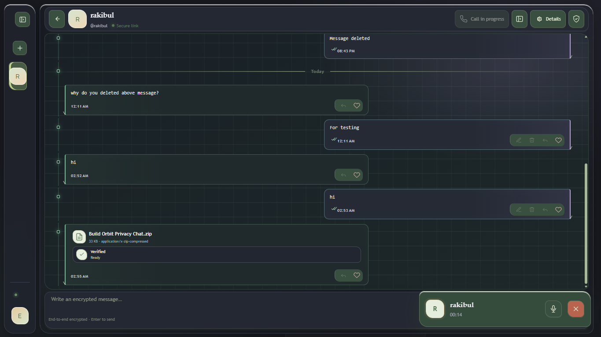

# Orbit


**Orbit is a privacy-focused, one-to-one messaging application** for conversations that feel personal without sacrificing control over your data. Send end-to-end encrypted text messages, share files directly between peers, and start audio calls in a compact workspace with several distinct visual themes.

The project is a full-stack TypeScript application: a React web client communicates with a NestJS API over HTTP and WebSockets, while PostgreSQL and Prisma persist accounts, conversations, and encrypted message data.

## Screenshots

The images below are served from the repository's `public/` directory and show the available sign-in, chat appearance, and audio-call experiences.

| Screen / appearance | Preview |
| --- | --- |
| Sign in |  |
| Storybook |  |
| Minimal |  |
| Watercolor |  |
| Anime |  |
| Midnight |  |
| Audio call |  |

## Features

- **End-to-end encrypted messages:** the browser derives a shared conversation key from the participants' public keys using ECDH and HKDF, then encrypts message content with AES-GCM before sending it to the API.
- **Real-time conversations:** a WebSocket connection carries message and conversation events, with session authentication and reconnect behavior.
- **Peer-to-peer file sharing:** files are transferred using WebRTC data channels rather than uploaded as message attachments to the API. Transfers include encrypted chunks, progress reporting, and integrity checks.
- **Folder sharing (Step 1):** share an encrypted folder/file-name structure in a conversation. Names, relative paths, sizes, and modification times are encrypted end-to-end; file contents are never read, transferred, or uploaded. Chromium uses the read-only directory picker; Safari and Firefox use a directory-input fallback (which cannot expose empty folders). Shares are limited to 50,000 entries, depth 64, names up to 255 characters, paths up to 1,024 characters, and 4 MiB of encrypted manifest data. The receiver can search and browse the shared tree; file transfer is not part of this step.
- **Folder exclusions:** before scanning a folder for sharing, choose common generated directories such as `node_modules`, `.git`, `dist`, and `build`, or enter additional directory names to exclude. Hidden files remain excluded by default and can be included during review. These choices are stored locally with the owner’s folder access settings and are not sent as separate server metadata.
- **Remote file downloads (Step 3):** recipients can download an individual shared file over a separate, encrypted WebRTC data channel. The browser requests bounded blocks, verifies each SHA-256 hash before writing, re-reads the completed sink, and compares a source root hash. The owner can disable downloads per share, sees active download progress, and can stop a transfer. The API relays signaling only; download bytes, names, and hashes are not sent to it.
- **Audio calls:** start and receive one-to-one calls, with call signaling over the WebSocket connection and audio carried by WebRTC.
- **Message controls:** edit and delete messages, reply, react, and track delivery/read receipts.
- **Conversation and account controls:** search for people, create conversations, manage blocked users, and refresh authenticated sessions.
- **Distinct chat appearances:** choose Storybook, Minimal, Watercolor, Anime, or Midnight themes. Each changes the workspace palette, decorative details, and message presentation.
- **Responsive workspace:** compact conversation navigation, message history, and composer are designed to adapt across screen sizes.
- **Local-first support:** browser-side storage supports device identity and local message caching; private keys are handled in the client.

### File-transfer network requirements

The API stores the encrypted file offer and coordinates the connection; the file bytes travel between the two browsers over an encrypted WebRTC data channel. STUN alone cannot connect peers on every mobile carrier, office, school, or restrictive Wi-Fi network. If the file card says the peer connection failed and no TURN relay is configured, add a TURN relay on the Render API service:

- `TURN_URLS`: comma-separated relay URLs, for example `turn:turn.example.net:3478?transport=udp,turn:turn.example.net:3478?transport=tcp,turns:turn.example.net:5349?transport=tcp` (use the actual URLs and ports supplied by your relay provider).
- For coturn REST/shared-secret authentication, set `TURN_SHARED_SECRET` to the private relay secret. Orbit generates short-lived credentials; `TURN_CREDENTIAL_TTL_SECONDS` optionally controls their lifetime (default `600`).
- For a provider that supplies a username and password, set `TURN_USERNAME` and `TURN_CREDENTIAL` to those values instead. Configure only one credential mode. Keep them out of source control and frontend build variables.

The authenticated API endpoint supplies the configured TURN credentials to the WebRTC clients for both file transfers and audio calls. After setting the variables, redeploy/restart the API and retry. TURN may relay encrypted WebRTC traffic when a direct peer path is unavailable; the application server still does not receive file contents or call audio.

Large-file receiving uses browser disk-backed storage when available. Browsers without that storage support are limited to 64 MiB per received file; available storage quota and the recipient device's resources can impose a lower practical limit. The sender and recipient both need a working WebRTC route, and the recipient must keep the conversation open until verification completes.

### Remote file preview (Step 2)

A recipient can open a supported file from a shared-folder tree while the folder owner is online. The recipient requests byte ranges by the manifest's numeric entry ID over an ordered WebRTC data channel; file names, paths, and file bytes are not sent to or stored by the API. Preview chunks are additionally AES-GCM encrypted with session keys derived using the existing ECDH/HKDF helper. The API validates the active share, participant, signaling direction, block state, and signaling rate, then relays only WebRTC signaling.

The owner must keep Orbit open and allow access to the shared folder. Chromium's directory picker handle is retained in IndexedDB so permission can be re-granted after reload. In browsers that only offer `webkitdirectory`, the selected `File` objects are held in memory; after reload the owner must select the same folder again. Revoking the share closes active preview sessions.

Previews are read-only and temporary. The viewer uses memory and object URLs, asks the private `/__preview/` Service Worker for byte ranges where available, and requests cancellation when a preview closes or a media element seeks. The worker has a root scope so it can control the app page, but it only intercepts `/__preview/` requests. Responses are marked `no-store` and `nosniff`. A browser without usable Service Worker streaming can preview whole files only up to 64 MiB.

### Shared-file downloads (Step 3)

Use **Download** on a shared file row or in its preview. Chromium browsers use the File System Access save picker; browsers without it use OPFS staging when available, otherwise an in-memory sink capped at 64 MiB. OPFS downloads are handed to the browser as a file after verification. The download journal is local to the recipient’s browser. The folder owner’s sharing dialog includes **Allow downloads**, and the owner can change that permission while download activity is visible.

Downloads are transferred in encrypted frames over `orbit-dl-v1`, separate from preview traffic. Progress is based on blocks that were hash-verified and written. Before completion Orbit commits the sink, re-reads its blocks, repairs mismatches, and checks its root hash against a fresh source verification from the owner. A source size, modification-time, or root mismatch prevents a successful completion. The folder owner must remain online and retain access to the shared source while a download runs.

The current download UI supports individual files and in-session pause/resume. Folder jobs, multi-select, automatic reconnect/reload resume, adaptive speed/ETA reporting, and cross-browser end-to-end performance testing are not yet available. In File System Access mode, progress not yet committed by the browser may be lost after a crash. OPFS staging needs free browser storage approximately equal to the file size; memory mode is limited to 64 MiB. Downloading is not a safety scan or a claim that the owner’s file is trustworthy.

### Presence and shared-folder availability (Step 4)

Presence is limited to unblocked one-to-one conversation partners. The authenticated server keeps connection and share-availability state in memory; it does not persist "last seen" timestamps. The browser reports online/away state, while the folder owner reports whether a share is available, needs permission, needs re-selection, or is paused. The server sees these states and whether downloads are allowed, but not folder names, paths, file contents, transfer byte counts, speeds, selected file IDs, or search queries. Presence and availability are discarded when connections expire. This implementation uses a single-process in-memory store; multi-instance deployments need a shared ephemeral store and pub/sub before scaling horizontally.

Privacy settings include **Appear offline**, **Show when I'm viewing shared folders**, and **Accept access requests**. Appearing offline hides presence and availability and prevents new previews/downloads from starting; transfers already in progress may continue. Viewing visibility is sent only to the folder owner, and actual file reads remain visible to the owner because their device serves the data. Access-request records contain lifecycle metadata and optional opaque encrypted notes; the server does not decrypt the notes. Requests are restricted to conversation partners and are subject to pending-request, cooldown, expiry, and payload limits.

Availability watches are stored locally in the browser. Browser notifications require an explicit opt-in and are intended only while Orbit is open in a tab; there is no Web Push when the app is closed. Folder names in notifications are a separate local opt-in. Incoming/updated request management, a full Notification center, unified Downloads/Uploads/Viewing Activity panel, People & Sharing page, and local shared-folder search index are not part of this implementation yet.

The Step 4 Prisma migration is additive. Review it and take a database backup before deployment; production deployment must use `prisma migrate deploy`, never a reset or destructive migration command. The public-discovery design is explicitly not implemented; see [the threat analysis and opt-in proposal](./docs/peer-discovery-public.md).

Supported previews are images (JPG/JPEG, PNG, WebP, GIF, AVIF, BMP, ICO, SVG in an image element only), PDF, plain text and Markdown, MP4/WebM video, browser-supported MOV/M4V video, MP3/WAV and browser-supported M4A/OGG/FLAC/AAC audio, and DOCX. Extensions are checked against file signatures before rendering; unsupported or mismatched files are not previewed. Text is limited to 10 MiB and DOCX to 25 MiB. DOCX output is simplified, sanitized, and shown in a sandboxed frame; legacy DOC files are not supported. Video/audio codecs depend on the recipient browser.

Use a current browser with WebRTC and Web Crypto support; Service Worker streaming requires HTTPS (or localhost). If peers cannot establish a direct connection, configure the same TURN settings described above: the viewer displays whether the selected connection is relayed. STUN alone does not work on every mobile carrier, office, school, or restrictive Wi-Fi network. The owner must be online for the entire preview; this feature does not synchronize changed files or retain a copy on the server.

> **Privacy note:** Orbit is designed so message plaintext is encrypted in the browser before it is sent to the server. Keep account credentials and device identity material private, use HTTPS/WSS in production, and review the implementation and deployment configuration before relying on the application for sensitive communications.

## Technology

| Area | Tools |
| --- | --- |
| Web client | React 19, TypeScript, Vite 8, Tailwind CSS 4 |
| API | NestJS 11, Node.js, Express, WebSockets (`@nestjs/platform-ws`, `ws`) |
| Database | PostgreSQL, Prisma 6 |
| Authentication | JWT (`jose`), Argon2 password hashing, secure HTTP-only cookie sessions |
| Client cryptography | Web Crypto API (ECDH, HKDF, AES-GCM) and `@noble/hashes` for file integrity |
| Peer-to-peer media and files | WebRTC (`RTCPeerConnection`, data channels) |
| Browser persistence | IndexedDB via Dexie, with browser key storage |
| Validation | Zod |
| Hosting configuration | Render Blueprint for the combined Node API and frontend service |

## Architecture at a glance

1. The React client signs in through the versioned HTTP API and keeps session credentials in secure cookies.
2. The browser establishes or loads a device identity and derives conversation keys locally. Plaintext is encrypted before a message is sent.
3. NestJS validates authenticated HTTP and WebSocket requests and stores encrypted message payloads and conversation metadata in PostgreSQL through Prisma.
4. The WebSocket gateway forwards real-time conversation events to connected participants.
5. For file sharing and calls, WebSocket messages coordinate WebRTC peers; media and file data are exchanged directly between browsers when the network allows it. TURN settings can be configured for deployments that need a relay.

## Learning and project goals

Orbit is also a practical study in building a privacy-aware full-stack product. Areas to explore include:

- Designing a typed React application with reusable conversation, message, and call components.
- Building modular NestJS controllers, services, repositories, WebSocket gateways, and request validation.
- Applying public-key agreement, key derivation, authenticated encryption, and secure handling of private keys in the browser.
- Coordinating real-time messaging, reconnection, message acknowledgements, and WebRTC signaling.
- Modeling relational data with Prisma and PostgreSQL while treating existing databases and migrations carefully.
- Configuring environment validation, CORS, health checks, graceful shutdown, and production frontend/API origins.
- Testing responsive layouts, accessibility, browser storage, and peer connections across different network conditions.

## Getting started

### Requirements

- Node.js 22 (recommended; used by the Render Blueprint)
- npm
- A PostgreSQL database for local development

### Install and configure

```bash
npm ci
```

Copy `.env.example` to `.env` and set `DATABASE_URL` to a **local or disposable development database**. Keep real credentials out of source control. The example file also documents server settings and optional frontend and TURN configuration.

Generate the Prisma client:

```bash
npm run prisma:generate
```

For a new local development database, review the checked-in migrations and apply them using:

```bash
npm run db:migrate:dev
```

Never point a development migration command at a production or otherwise valuable database. For an existing database, follow the baseline and migration cautions in [Deployment (Render)](#deployment-render) instead.

### Run the application

Start the API in one terminal:

```bash
npm run dev:server
```

Start the Vite frontend in another terminal:

```bash
npm run dev
```

The Vite development server proxies API and WebSocket traffic to `API_PORT` (default `3000`). Open the local address printed by Vite (the current configuration defaults to port `8443`). For local development with a separately hosted API, set `VITE_API_URL` and `VITE_WS_URL`; the production Render build intentionally leaves them unset so the app, API, and WebSocket share one origin.

## Useful commands

| Command | Purpose |
| --- | --- |
| `npm run dev` | Start the Vite frontend development server. |
| `npm run dev:server` | Start the NestJS API in watch mode. |
| `npm run typecheck` | Type-check the frontend and server TypeScript projects. |
| `npm run prisma:generate` | Generate the Prisma client. |
| `npm run build` | Build the frontend into `dist/`. |
| `npm run build:server` | Compile the API into `server-dist/`. |
| `npm run start:server` | Start the compiled API. |
| `npm run test:shared-folders` | Run folder-manifest, crypto, limits, and authorization tests. |
| `npm run check:no-demo` | Check the repository for disallowed demo content. |
| `npm run db:verify` | Run the database invariant checks in `scripts/verify-db.sql`. |

## Deployment (Render)

The root `render.yaml` defines one `orbit-api` Node web service that builds and serves both the API and frontend from the same origin. This avoids cross-site refresh-cookie restrictions in browsers such as iPhone Safari. The app is available at the API service URL (currently `https://orbit-api-pr3d.onrender.com`); the separate `orbit-web` static site is no longer used. The build runs `prisma migrate deploy`; review pending migrations and take a database backup before deploying. Do not use `prisma migrate reset` or force-reset commands on an existing database.

### Environment variables

| Service | Variable | Value format / source |
| --- | --- | --- |
| `orbit-api` | `DATABASE_URL` | PostgreSQL connection URL from your database provider; use TLS (`sslmode=require`) and its pooled URL if that is the app connection URL. |
| `orbit-api` | `DIRECT_URL` | Direct/non-pooled PostgreSQL URL from the same provider for Prisma migrations; use the direct URL also if the provider has no pooler. |
| `orbit-api` | `JWT_SECRET` | Random, private value with at least 32 characters. Generate independently; never reuse a development or cookie secret. |
| `orbit-api` | `COOKIE_SECRET` | A second, independent random private value with at least 32 characters. |
| `orbit-api` | `CORS_ORIGIN` | Exact app/API origin, e.g. `https://orbit-api-pr3d.onrender.com`; multiple origins may be comma-separated. No paths or `*`. |
| `orbit-api` | `NODE_ENV` | Set by the Blueprint to `production`. |
| `orbit-api` | `AUTH_COOKIE_PATH` | Set by the Blueprint to `/v1/auth`. |
| `orbit-api` | `NODE_VERSION` | Set by the Blueprint to `22`. |

Do not set `VITE_API_URL` or `VITE_WS_URL` on the Render service: production builds deliberately use relative same-origin `/v1` and `/v1/ws` endpoints. Set `CORS_ORIGIN` to the exact API/app origin. Set secrets and provider URLs in the Render dashboard; do not put real values in `render.yaml`, `.env.example`, or source control. Optional TURN uses `TURN_URLS` plus either `TURN_SHARED_SECRET` (coturn REST) or both `TURN_USERNAME` and `TURN_CREDENTIAL` (static provider credentials); do not configure both authentication modes. `TURN_CREDENTIAL_TTL_SECONDS` applies to coturn REST credentials and defaults to 600.

### Existing database and deployment order

1. Confirm the target database and take a provider-managed backup. Inspect the existing `_prisma_migrations` history and compare the schema with `prisma/schema.prisma` and the checked-in migrations. The app does not automatically verify that a database has the expected schema.
2. **Baseline only when required:** if this existing database already contains the schema from `20261025160000_init` but has no Prisma migration history, and you have confirmed the schema matches that migration, run `npm run db:migrate:baseline:legacy` against that database once. It records the initial migration as applied; it does not create the schema. Skip this step if migration history already exists. Never baseline an empty or mismatched database.
3. Before allowing the API Blueprint build to run, review each pending migration and the effects it will have on the existing data. The legacy transition migration includes cleanup of reactions and file transfers for already-deleted messages, among other schema/data transitions. `npm run db:verify` checks stored-data invariants after migration; it is not a full schema introspection tool.
4. Configure the `orbit-api` service with the database URLs, generated secrets, `CORS_ORIGIN` set to the API's public Render URL, and `AUTH_COOKIE_PATH=/v1/auth`. Remove any previously configured `VITE_API_URL` or `VITE_WS_URL` values from the API service. Deploy the Blueprint; its build generates Prisma, builds the frontend into `dist`, compiles the API, and runs `npm run db:migrate:deploy`.
5. Open the app at the `orbit-api` service URL (currently `https://orbit-api-pr3d.onrender.com`). The previous `orbit-web` static site URL is not the application URL for this same-origin setup; retire that service after confirming the combined API/app is healthy. Confirm sign-in, refresh, and an authenticated WebSocket connection on desktop and iPhone Safari.

To run the one-time baseline manually, use the same carefully verified `DATABASE_URL`/`DIRECT_URL` environment that targets the existing database; do not paste credentials into shell history or commit them.

### Troubleshooting

- API fails during startup with environment validation: check the required server variables, PostgreSQL URL/TLS settings, and that both secrets are independent random values of at least 32 characters.
- API health returns `503`: inspect Render API logs and database availability/connection limits. `/health` executes `SELECT 1`.
- Browser reports CORS errors: set `CORS_ORIGIN` to the exact API/app origin (scheme and host only), then restart the API.
- WebSocket fails: confirm the app and API are opened at the same service origin and the browser has a valid signed-in session.
- Static routes return `404`: confirm the API build completed `npm run build` and the `dist/` output was included in the deployed service.
